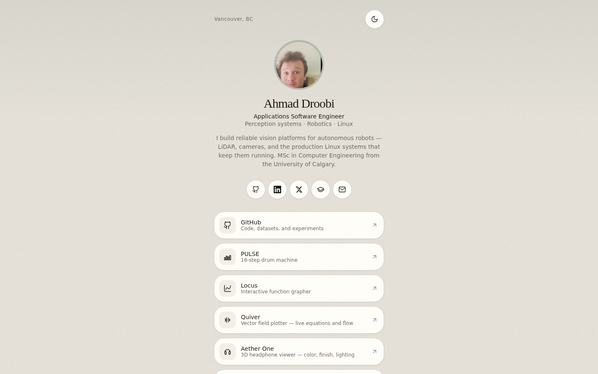

# Ahmad Droobi — Engineering Portfolio

Enterprise engineering portfolio and GitHub repository explorer for [ahmaddroobi99](https://github.com/ahmaddroobi99).

The GitHub **profile README** still belongs in the username repository. This application is the **portfolio operating system** in front of that account: it discovers original public repositories at build time, ranks up to 50 of them with a transparent **Project Signal Score**, and presents each as a short case study.

**Live:** [ahmaddroobi99.github.io](https://ahmaddroobi99.github.io/)



## What this is

- Home: identity, domains, featured projects (breadth, not stars)
- Project explorer: search, filters, sort
- Top 50: four-line summaries, images/GIFs when present
- Project pages: mini case studies from README + GitHub metadata only
- Constellation, technology graph, timeline
- Maintenance center: missing README / license / demo / screenshots
- Command palette: `Ctrl/Cmd + K`

## What this is not

No invented employers, awards, benchmarks, users, or technologies. Forks of upstream libraries are excluded from ranking. Stars are **5%** of the score.

### Project Signal Score

| Signal | Weight |
| --- | --- |
| Technical relevance | 25% |
| Activity / maintenance | 20% |
| Documentation | 15% |
| Visual / demo | 15% |
| Engineering complexity | 10% |
| GitHub stars | 5% |
| Completeness | 5% |
| Recency | 5% |

## Stack

TanStack Start · React 19 · Tailwind v4 · static `repositories.json`

Runtime GitHub API calls are **not** made on page load. Refresh data:

```bash
python3 scripts/fetch-repositories.py
```

The production site keeps working if GitHub is down because the catalog is bundled.

## Scripts

```bash
npm install
npm run dev
npm run build
npm run preview
npm run lint
npm run typecheck
```

## Related

- Profile README: [ahmaddroobi99/ahmaddroobi99](https://github.com/ahmaddroobi99/ahmaddroobi99)
- LinkedIn: [linkedin.com/in/droobi7](https://www.linkedin.com/in/droobi7/)
- Featured lab: [qg-lada-lab](https://github.com/ahmaddroobi99/qg-lada-lab)

---

Account grouping: research first, undergraduate last — see the [profile README](https://github.com/ahmaddroobi99/ahmaddroobi99). GitHub cannot custom-sort the Repositories tab.

